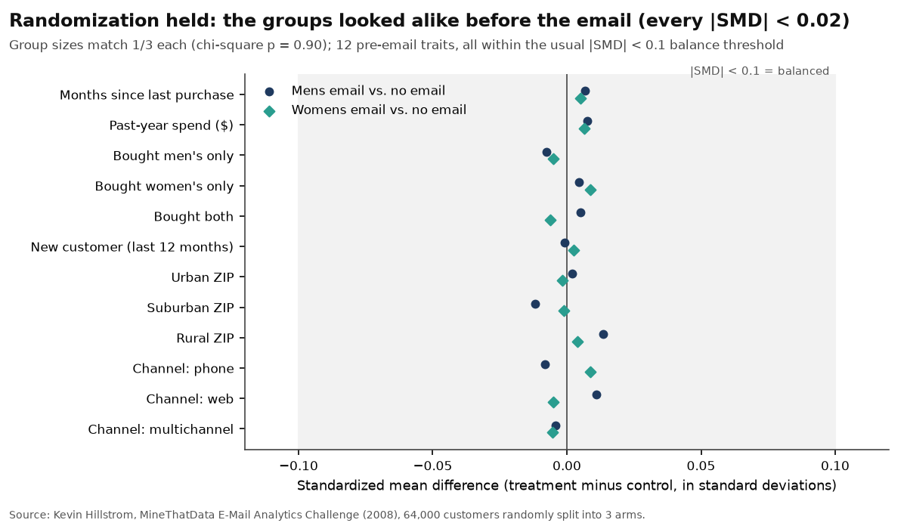
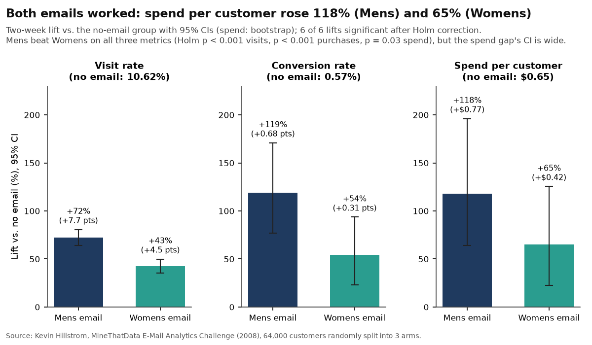
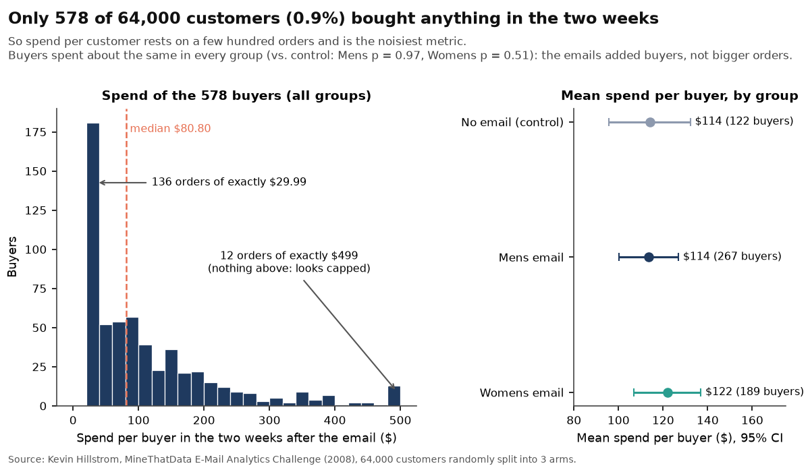
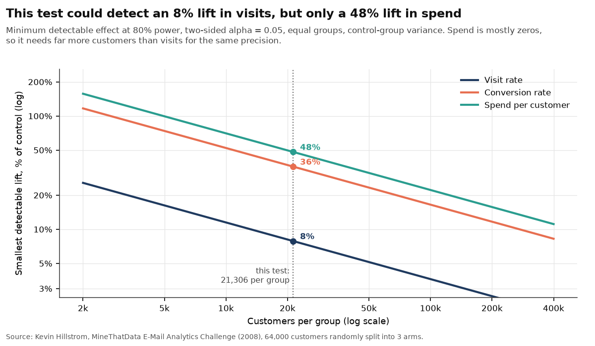
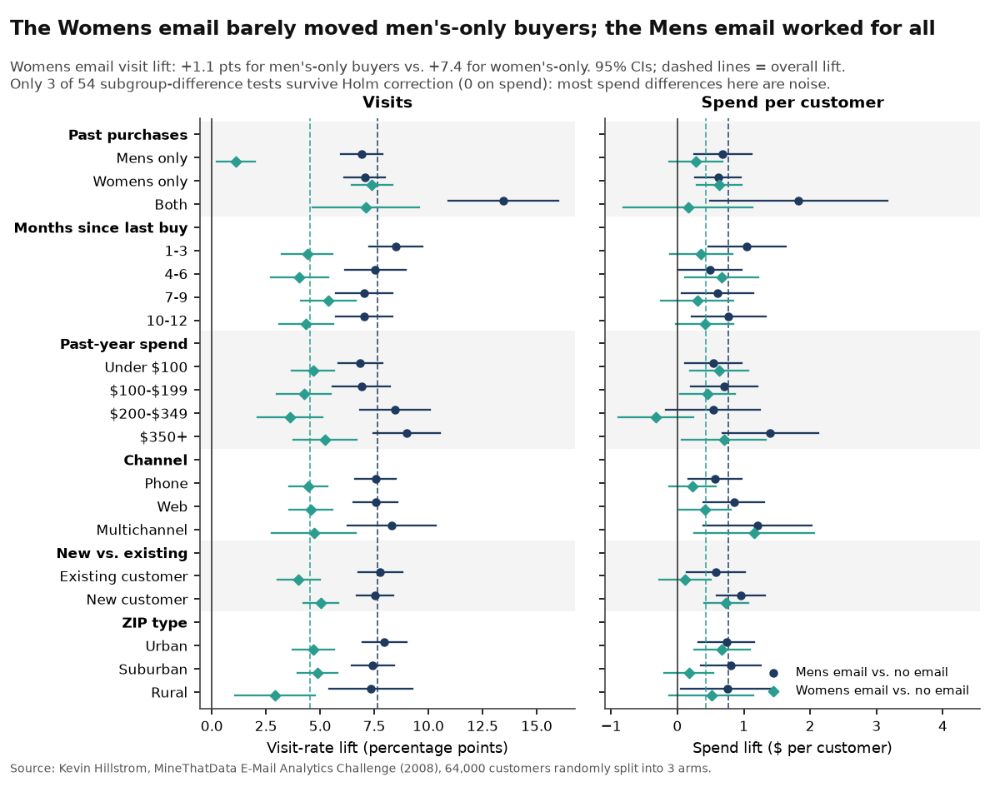
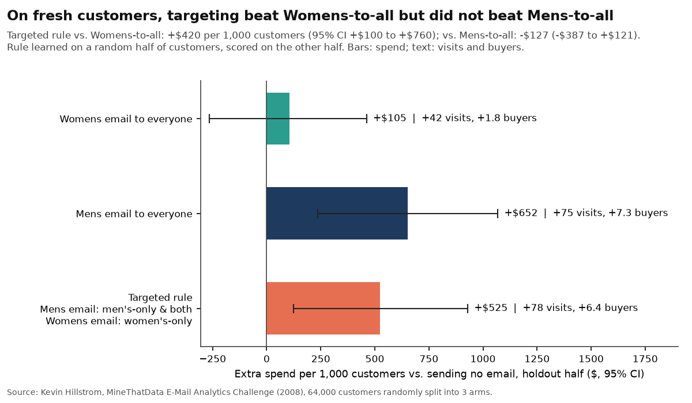

# Email Campaign A/B/n Test: did it work, for whom, and who should get it next time?

Did emailing recent customers a men's- or a women's-merchandise campaign raise website visits, purchases and revenue over the next two weeks compared with sending nothing, and which customers should get which email next time?

## Stakeholder readout

Both emails raised revenue, and the Mens email raised it more. In the two weeks after the send, customers who got the Mens email spent $1.42 on average against $0.65 for customers who got no email: **+$0.77 per customer (95% CI $0.49 to $1.06), or about +$770 per 1,000 customers emailed**. The Womens email added +$0.42 per customer (95% CI $0.17 to $0.68). The Womens email worked mainly on customers who already buy women's merchandise: among men's-only buyers it raised website visits by just +1.1 pts, against +6.9 pts for the Mens email. A rule that sends women's-only buyers the Womens email and everyone else the Mens email beat "Womens email to everyone" on customers it was not built on (+$420 per 1,000 customers), but it did not beat simply sending everyone the Mens email (−$127 per 1,000, 95% CI −$387 to +$121), and in 500 re-runs on different random splits it came out ahead only 7% of the time. **Next campaign: send the Mens email to everyone, keep a random no-email group so the lift can still be measured, and judge revenue only on much larger tests.** Only 578 of 64,000 customers bought anything, so detecting a 10% revenue lift would take 494,680 customers per group.

## Business questions

- Did each email lift visits, purchases and spend against sending no email, and by how much per 1,000 customers?
- Which email worked better, and does the difference hold up after correcting for multiple comparisons?
- Was the test big enough to measure each metric (minimum detectable effect)?
- Did the effect differ by customer segment (past purchases, recency, past-year spend, channel, new vs. existing, ZIP type)?
- Who should get which email next time, and does targeting beat a blanket send on customers the rule was not built on?

## Data

- **Source:** Kevin Hillstrom, ["The MineThatData E-Mail Analytics And Data Mining Challenge"](https://blog.minethatdata.com/2008/03/minethatdata-e-mail-analytics-and-data.html), MineThatData blog, March 20, 2008. File: [`Kevin_Hillstrom_MineThatData_E-MailAnalytics_DataMiningChallenge_2008.03.20.csv`](http://www.minethatdata.com/Kevin_Hillstrom_MineThatData_E-MailAnalytics_DataMiningChallenge_2008.03.20.csv).
- **Design, as the author describes it:** 64,000 customers who last purchased within twelve months were in an e-mail test. One third were randomly chosen to receive an e-mail featuring men's merchandise, one third an e-mail featuring women's merchandise, and one third no e-mail; visits, purchases and spend were tracked during the two weeks after the campaign. The post does not say when the e-mail was sent or name the retailer; the file is dated March 2008.
- **One row = one customer.** Eight pre-email attributes (months since last purchase, past-year spend and its band, whether they bought men's and/or women's merchandise last year, new-customer flag, ZIP type, purchase channel), the assigned group, and three outcomes (visited the website, bought, dollars spent in the two weeks). 64,000 rows, twelve columns, no missing values.
- **Terms:** the post states no license. The author published the file openly for anyone to analyse in his challenge; copyright stays with him. Neither the raw file nor the cleaned copy is committed: `src/get_data.py` downloads the file from the author's site and checks its SHA-256, and `src/prepare.py` rebuilds `data/processed/`.
- **Data quality** (SQL checks in DuckDB, [`results/data_quality.csv`](results/data_quality.csv)):
  - "Suburban" is misspelled "Surburban" in all 28,776 suburban rows; recoded.
  - Spend is positive exactly when the customer bought. Only 578 customers (0.9%) bought anything.
  - Spend tops out at exactly $499 for 12 buyers, and the next-highest order is $482.31, so the field looks capped (top-coded); if so, the largest orders are understated.
  - 6,562 rows repeat another row in all twelve columns; 6,530 of those sit at the $29.99 past-year-spend floor, where identical profiles are expected. There is no customer ID to tell them apart, so all rows are kept.

## Approach

1. **Ingest and validate** (`src/get_data.py`, `src/prepare.py`): download, SHA-256 check, schema and range validation with pandas, cleaning, derived segment columns.
2. **SQL** (`sql/`, `src/sql_checks.py`): data-quality checks and an arm summary in DuckDB with window functions, cross-checked against pandas.
3. **Randomization check**: sample-ratio-mismatch (SRM) chi-square test, standardized mean differences, and a multinomial-logit joint balance test (statsmodels).
4. **A/B/n testing**: two-proportion z-tests, Welch's t-test, bootstrap confidence intervals (10,000 resamples), relative-lift CIs, and a Holm correction across the family of 9 tests.
5. **Power analysis**: minimum detectable effect (MDE) and sample-size planning.
6. **Variance reduction**: OLS regression adjustment with HC2 robust standard errors, CUPED, and the Lin (2013) interacted estimator.
7. **Heterogeneous treatment effects**: 19 subgroups defined up front from the customer attributes, Cochran's Q heterogeneity tests with Holm correction, and an interaction regression.
8. **Targeting policy**: 50/50 train/holdout split, a rule learned on the training half, off-policy (post-stratified) evaluation on the holdout with bootstrap CIs, a 500-split robustness check, and an ROI sensitivity table built on labelled assumptions.
9. **Reporting and automation**: matplotlib charts, an executed Jupyter notebook, one entry point that rebuilds everything, and a script that checks every number in this README against `results/`.

Tools: Python 3.12, pandas, NumPy, SciPy, statsmodels, DuckDB (SQL), matplotlib, Jupyter.

## Key findings

### 1. The randomization was clean

Group sizes of 21,306 (no email), 21,307 (Mens) and 21,387 (Womens) match a one-third split (SRM chi-square p = 0.90). Every pre-email trait is balanced (largest standardized mean difference 0.017, against the usual 0.1 threshold), and a joint test finds no trait that predicts the group (p = 0.87). Differences between the groups can be read as caused by the emails.



### 2. Both emails lifted all three metrics; the Mens email lifted them more

| Two weeks after the send | No email | Mens email | Womens email |
|---|---|---|---|
| Visited the website | 10.62% | 18.28% | 15.14% |
| Bought | 0.57% | 1.25% | 0.88% |
| Spend per customer | $0.65 | $1.42 | $1.08 |

| Effect (95% CI) | Mens vs. no email | Womens vs. no email | Mens vs. Womens |
|---|---|---|---|
| Visit rate | +7.66 pts (7.00 to 8.32), +72% | +4.52 pts (3.89 to 5.16), +43% | +3.14 pts (2.43 to 3.84) |
| Conversion rate | +0.68 pts (0.50 to 0.86), +119% | +0.31 pts (0.15 to 0.47), +54% | +0.37 pts (0.17 to 0.56) |
| Spend per customer | +$0.77 ($0.49 to $1.06), +118% | +$0.42 ($0.17 to $0.68), +65% | +$0.35 ($0.04 to $0.66) |
| Holm-adjusted p: visits / buyers / spend | < 0.001 / < 0.001 / < 0.001 | < 0.001 / < 0.001 / 0.002 | < 0.001 / < 0.001 / 0.03 |

Per 1,000 customers emailed, the Mens email produced +77 visits, +6.8 buyers and +$770 of spend; the Womens email +45 visits, +3.1 buyers and +$424. All 9 comparisons stay significant after the Holm correction. The Mens email's spend edge over the Womens email is real but loosely measured: +$0.35 per customer with a CI from $0.04 to $0.66 (Holm p = 0.03). Spend CIs are bootstrapped; Welch's t-test gives nearly identical intervals.



### 3. Spend is the noisy metric, and the emails created buyers, not bigger baskets

Only 578 of 64,000 customers bought anything: 122 in the no-email group, 267 with the Mens email and 189 with the Womens email. That is why the spend lift's 95% CI spans ±38% of the estimate, against ±9% for visits; measuring average spend with the same relative precision as the visit rate would take about 37× as many customers. Buyers spent about the same in every group ($114, $114 and $122; neither email's difference from control is significant, p = 0.97 and 0.51), so more buyers account for 101% of the Mens spend lift (Mens buyers spent slightly less per order) and 84% of the Womens lift. Spend per buyer compares people selected after the email, so it is a descriptive comparison, not a randomized one.



### 4. The test was sized for visits, not revenue

At this sample size the test could reliably detect (80% power, two-sided α = 0.05) a relative lift of 8% in visits and 36% in purchases, but only 48% in spend per customer. The Mens email's visit lift was 9.2× its MDE; its spend lift only 2.4×. Detecting a 10% spend lift would need 494,680 customers per group (23× this test), against 13,217 per group for a 10% visit lift. Confirming the Mens-vs-Womens spend gap with 80% power would need 35,768 per group (1.7× this test).



### 5. Regression adjustment (the CUPED idea) left the answer unchanged and barely helped here

| Mens vs. no email | Difference in means (robust SE) | OLS + pre-email covariates (robust SE) | Change in SE |
|---|---|---|---|
| Visit rate, pts | +7.66 pts (0.339) | +7.61 pts (0.334) | −1.4% |
| Spend per customer, $ | +$0.77 (0.1452) | +$0.77 (0.1451) | −0.1% |

Adding the pre-email covariates moved every effect estimate by < 0.05 pts for visits and < $0.01 for spend, and shrank the visit standard error by 1.4%, worth about 2.9% more customers. Conversion and spend standard errors changed by 0.1% or less. Of the variance left after the group effect, the covariates explain only 2.6% for visits and 0.1% for spend, and CUPED with past-year spend as the covariate does even less: its correlation with visits is 0.065 and with spend 0.022, and CUPED cuts variance by roughly the squared correlation. CUPED needs a covariate strongly correlated with the outcome, typically the same metric measured before the test, which this file does not have.

### 6. For whom: the Womens email worked mainly on customers who buy women's merchandise

Of the 54 tests of "does the effect differ by segment?" (six segment dimensions × three comparisons × three metrics), only 3 survive the Holm correction, and all three are about past purchases and visits. The Womens email raised visits by +7.4 pts among women's-only buyers and +7.1 pts among customers who bought both, but only +1.1 pts (95% CI +0.2 pts to +2.0 pts) among men's-only buyers. An interaction regression puts the gap between women's-only and men's-only buyers at +6.3 pts (95% CI 5.0 to 7.6; Wald χ² = 97.3, p < 0.001). The Mens email lifted visits in all 19 subgroups (+6.9 pts for men's-only, +7.1 pts for women's-only and +13.4 pts for buyers of both) and lifted spend with a CI above zero in 18 of 19. No difference in spend between segments survives the correction. For example, the Womens email's spend lift ranges from −$0.32 to +$0.70 across past-spend bands (raw p = 0.04, Holm p = 1.00): the kind of swing that slicing a noisy metric 19 ways produces by chance.



### 7. Targeting by past purchases did not beat "Mens email to everyone" on held-out customers

On a random half of customers (training, 32,000) the rule picked the email with the larger spend lift in each past-purchase group: the Mens email for men's-only buyers (+$0.79 against +$0.68 for Womens) and for buyers of both (+$3.36 against +$1.04), and the Womens email for women's-only buyers (+$0.75 against +$0.43). Scored on the other 32,000 customers:

| Holdout half, per 1,000 customers (95% CI) | Targeted rule vs. no email | vs. Womens email to everyone | vs. Mens email to everyone |
|---|---|---|---|
| Extra visits | +78 (+68 to +87) | +35 (+28 to +43) | +2 (−4 to +9) |
| Extra buyers | +6.4 (+3.8 to +8.9) | +4.6 (+2.6 to +6.6) | −0.9 (−2.8 to +0.9) |
| Extra spend | +$525 (+$124 to +$930) | +$420 (+$100 to +$760) | −$127 (−$387 to +$121) |

On the same holdout, "Mens email to everyone" earned +$652 per 1,000 against no email (+$235 to +$1,069) and +$547 against "Womens email to everyone" (+$136 to +$963). Holdout lifts against no email run lower than the full-sample ones because the holdout's no-email group happened to spend more ($0.80 per customer against $0.65 in the full no-email group); policy-against-policy comparisons do not use that group. The rule's training-half value ($1,031 per 1,000) shrank 49% on the holdout ($525), the usual optimism of an in-sample winner. On the holdout alone, the rule-vs-Mens comparison could only detect a difference of $363 per 1,000 (80% power), so it cannot rule out a small gain. But the rule differs from "Mens to everyone" only for women's-only buyers, and in the full sample the two emails tie there (Mens minus Womens −$0.02 per customer, 95% CI −$0.42 to +$0.39). Repeating the whole split, learn and score procedure 500 times, the rule beat Womens-to-all in 98% of splits but beat Mens-to-all in only 7% (mean −$47 per 1,000, 95th percentile +$3). Both emails raised visits in all 19 segments, and no segment's spend fell significantly, so this data gives no reason to leave anyone out of the send.



## Recommendations

1. **Send the Mens email to everyone in the next campaign.** It had the largest lift on every metric, worked in every segment, and no targeting rule tested here beat it on held-out customers. Never send the Womens email to men's-only buyers; for women's-only buyers the two emails performed about the same.
2. **Keep a random no-email group in every send.** Customers buy without an email ($0.65 per customer in two weeks here), so only a randomized holdout shows what the email added.
3. **Choose the primary metric the test can measure.** Use visits or purchases for quick reads and judge revenue on pooled campaigns or much larger tests (a 10% spend lift needs 494,680 customers per group).
4. **Log each customer's pre-period visits and spend** (for example, the weeks before the send) so a CUPED-style adjustment can cut the variance; the attributes in this file explain too little to help.
5. **The Mens email pays for itself under every assumption tested.** Margins and email costs are not in the data, so they are assumptions here: breakeven cost per email = assumed gross margin × spend lift per customer emailed.

| Assumed gross margin | Mens email: breakeven cost per email (at CI low end) | Womens email: breakeven cost per email (at CI low end) |
|---|---|---|
| 30% | $0.23 ($0.15) | $0.13 ($0.05) |
| 40% | $0.31 ($0.19) | $0.17 ($0.07) |
| 50% | $0.38 ($0.24) | $0.21 ($0.09) |

Even at an assumed $0.10 per email and a 30% margin, the Mens email's gross profit stays positive at the low end of its CI (+$46 per 1,000 customers); the Womens email's does not (−$48). The full grid ($0.001, $0.01 and $0.10 per email) is in [`results/roi_sensitivity.csv`](results/roi_sensitivity.csv).

## Technical details

- **Binary metrics** (visit, conversion): two-proportion z-test (pooled SE for the test, unpooled SE for the CI); relative-lift CI on the log ratio (Katz).
- **Spend:** Welch's t-test plus a bootstrap percentile CI with 10,000 resamples. Since 99.1% of spend values are zero, each resample draws the number of buyers from Binomial(n, k/n) and resamples only buyers. That is exactly the distribution of the textbook row bootstrap, at a fraction of the cost; [`results/bootstrap_check.csv`](results/bootstrap_check.csv) shows the standard errors agree with a row bootstrap and with the analytic SE.
- **Multiple comparisons:** Holm-Bonferroni across the 9 main tests and, separately, across the 54 heterogeneity tests.
- **Power:** MDE = 2.80 × SE (two-sided α = 0.05, 80% power). The design MDE uses the control group's variance for both groups; subgroup and holdout tables use the observed SE.
- **Regression adjustment:** OLS with HC2 robust SEs; without covariates the HC2 SE equals Welch's exactly (asserted in code). CUPED: Y − θ(X − mean X) with θ = cov(Y, X) / var(X) and X = past-year spend. The Lin (2013) fully interacted estimator is reported as a robustness check.
- **Heterogeneity:** Cochran's Q for each dimension × comparison × metric. The strongest pattern is re-estimated as OLS with group × segment interactions; its HC2 Wald test reproduces Q exactly (asserted in code).
- **Policy evaluation:** email was randomized within every segment, so a policy's value is the sum over segments of segment share × mean outcome of the arm that policy assigns to the segment (a post-stratified difference in means, unbiased under randomization). CIs: 5,000 bootstrap resamples of the holdout, resampling within each arm. Split: seeded random permutation (seed 20080320). A diagnostic file scores all six one-variable rules on both halves; it was not used to pick the rule.
- **Number check:** `src/key_numbers.py` collects every number this README cites from `results/` into [`results/key_numbers.csv`](results/key_numbers.csv), and `src/verify_readme.py` fails the build if the README contains a number that is not there ([`results/readme_number_check.csv`](results/readme_number_check.csv)).

## Repo structure

```
email-campaign-ab-test/
├── README.md
├── LICENSE
├── requirements.txt
├── .gitignore
├── data/
│   ├── raw/hillstrom/            # downloaded CSV (gitignored; get_data.py re-downloads and checks SHA-256)
│   └── processed/hillstrom_clean.csv   # rebuilt by prepare.py (gitignored)
├── sql/
│   ├── 01_data_quality.sql       # data-quality checks (DuckDB)
│   └── 02_arm_summary.sql        # arm summary with window functions
├── src/
│   ├── run_all.py                # ONE entry point: rebuilds everything below
│   ├── config.py                 # paths, seed, constants, chart palette
│   ├── get_data.py               # download + checksum
│   ├── prepare.py                # validate, clean, derive segments
│   ├── sql_checks.py             # runs the SQL, cross-checks with pandas
│   ├── stats_utils.py            # tests, CIs, Holm, SMD, MDE, bootstrap
│   ├── plots.py                  # chart style
│   ├── s01_randomization.py      # SRM, balance, joint test
│   ├── s02_main_effects.py       # lifts, bootstrap, Holm, spend precision
│   ├── s03_power.py              # MDE and sample-size planning
│   ├── s04_regression_adjustment.py   # OLS (HC2), CUPED, Lin
│   ├── s05_heterogeneity.py      # subgroups, Cochran's Q, interaction model
│   ├── s06_targeting_policy.py   # train/holdout policy evaluation, ROI
│   ├── key_numbers.py            # README numbers -> results/key_numbers.csv
│   ├── build_notebook.py         # writes and executes the notebook
│   └── verify_readme.py          # checks README numbers against results/
├── notebooks/ab_test_analysis.ipynb   # narrated, executed walkthrough
├── results/                      # every CSV behind every number
└── images/                       # charts used above
```

## How to reproduce

```bash
python3.12 -m venv .venv && source .venv/bin/activate
pip install -r requirements.txt
python -I src/run_all.py
```

`run_all.py` downloads the CSV if it is missing (and checks its SHA-256), deletes and rebuilds `data/processed/`, `results/` and `images/`, executes the notebook, and finishes by checking every number in this README against `results/`.

## Limitations & next steps

- **Two weeks only.** The data shows two-week visits, purchases and spend; it says nothing about later purchases, unsubscribes or email fatigue, which are the main real costs of sending more email.
- **Spend looks capped at $499.** If so, the largest orders are understated (this affects spend only).
- **No customer ID.** The 6,562 exact duplicate rows are treated as distinct customers with identical profiles.
- **One campaign from 2008, one unnamed retailer.** Effects may not carry over to other products, seasons or audiences.
- **Revenue, not profit.** The ROI figures rest on the stated assumptions about margin and email cost.
- **Subgroups are exploratory.** The six dimensions are the attributes the challenge describes, with cut-points set by group size rather than by outcomes. The targeting rule segments by past purchases for a business reason (the emails feature men's and women's merchandise), but that is also the strongest pattern in the subgroup analysis, which used all customers. The holdout and the 500-split check guard against overfitting the email chosen for each segment, not against that choice of segmentation.
- **Next steps:** an uplift model (for example, a two-model approach or a causal forest) with a Qini curve to rank individual customers, which answers the challenge's "best 10,000 customers" question; a follow-up test sized for spend; and sequential-testing rules if results will be checked before a test ends.

---

Author: Jude (Joochan) Lee · GitHub [@ratemyguy](https://github.com/ratemyguy) · [LinkedIn](https://www.linkedin.com/in/judeee)
